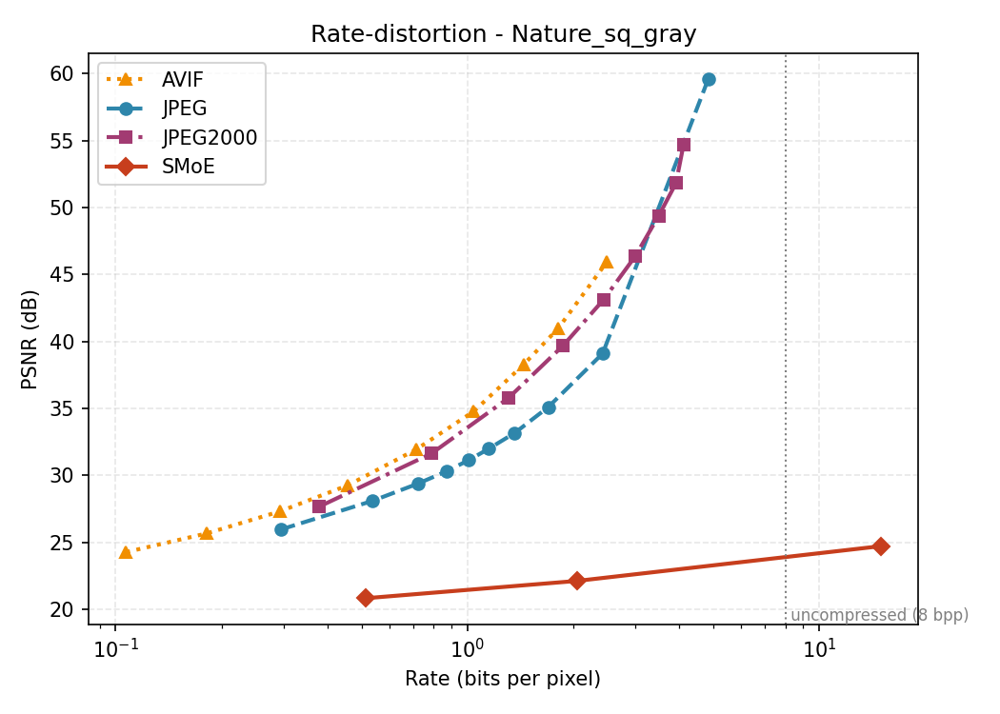

# Image Compression Benchmark — Classical Codecs vs. Steered Mixture of Experts

Benchmarking three standardised codecs — **JPEG**, **JPEG 2000** and **AVIF** — against a
per-image learned representation, the **Steered Mixture of Experts (SMoE)** model of
Bochinski et al. (ICIP 2018), on five 8-bit grayscale images.

**Leonardo Stefani** · Mid Sweden University, Sundsvall

The full write-up is in [`paper/conference.pdf`](paper/conference.pdf). These results supersede an
earlier version of the study; see [Correction to the earlier version](#correction-to-the-earlier-version).

## What this is

Classical codecs compress with a *fixed* transform — block DCT for JPEG, a discrete
wavelet transform for JPEG 2000, an AV1 intra transform for AVIF — followed by
quantisation and entropy coding. SMoE inverts the idea: it treats compression as a
**per-image regression problem**, fitting a sparse mixture of steered Gaussian kernels
whose weighted sum approximates the pixel field, and transmits the *model parameters*
rather than transform coefficients.

The question is whether that adaptive, edge-aware representation earns its cost.

**Short answer: no, on all three axes.** SMoE is slower by three to five orders of
magnitude, lower in fidelity at every kernel budget tested, and — once rate is measured
correctly — more expensive in bits as well.

| | Question | Finding |
|---|---|---|
| **RQ1** | SMoE vs. classical on PSNR/SSIM? | SMoE trails all three at every budget. |
| **RQ2** | Quality vs. size vs. time? | All rise together, but at wildly different rates. SMoE's time cost grows fastest. |
| **RQ3** | Is SMoE computationally feasible? | No. 8–210 min/image vs. 0.04–2 s. |

## Results

Aggregate over all lossy operating points (lossless points excluded — see below).
Regenerate with `python scripts/05_aggregate.py`.

| Codec | Points | PSNR mean | PSNR range | SSIM mean | bpp range |
|---|---|---|---|---|---|
| **AVIF** | 45 | **42.81 dB** | 24.28 – 61.33 | **0.965** | 0.008 – 2.49 |
| **JPEG 2000** | 45 | 42.67 dB | 24.88 – 57.34 | **0.967** | 0.001 – 4.11 |
| **JPEG** | 50 | 41.48 dB | 25.97 – 67.88 | 0.958 | 0.035 – 4.83 |
| **SMoE** | 14 | **29.66 dB** | 20.84 – 39.66 | **0.859** | 0.387 – 20.13 |

### The comparison that matters: matched rate

Averaging over each codec's own quality ladder is only weakly informative, because the
ladders are not comparable. The sharper question is: **at the same number of bits, who
wins?** Every SMoE point paired with classical points within ±15 % bpp:

| Image | SMoE | bpp | SMoE PSNR | Best rival at that rate | Gap |
|---|---|---|---|---|---|
| Gradient | $K=16$ | 0.45 | 39.56 dB | JPEG 2000 Q80 — 53.79 dB | **−14.2 dB** |
| Grass | $K=16$ | 0.45 | 22.09 dB | AVIF Q80 — 48.62 dB | **−26.5 dB** |
| Mixed | $K=16$ | 0.39 | 23.07 dB | AVIF Q80 — 48.76 dB | **−25.7 dB** |
| Nature | $K=16$ | 0.51 | 20.84 dB | AVIF Q40 — 29.26 dB | **−8.4 dB** |
| Nature | $K=32$ | 2.05 | 22.13 dB | AVIF Q80 — 40.98 dB | **−18.9 dB** |

SMoE is 8 to 27 dB behind at equal bitrate. Full table in
`results/metrics/matched_rate_comparison.csv`.



The three classical curves cluster tightly; SMoE sits far below all of them, and its
best-quality point lands to the *right* of the 8 bpp uncompressed reference — it costs
more than sending the raw image.

## Quick start

```bash
git clone https://github.com/stefanileonardo/image-compression-benchmark.git
cd image-compression-benchmark

python -m venv .venv
source .venv/bin/activate          # Windows: .venv\Scripts\activate
pip install -r requirements.txt

python scripts/01_preprocess.py    # data/raw -> data/processed  (seconds)
python scripts/02_run_classical.py # JPEG / JPEG 2000 / AVIF sweeps  (~10 min, CPU)
python scripts/04_smoe_metrics.py  # SMoE rate + distortion from shipped params (seconds)
python scripts/05_aggregate.py     # tables -> results/metrics/
python scripts/06_make_figures.py  # figures -> results/figures/
```

That reproduces every table and figure **without retraining SMoE**, because the fitted
parameters ship with the repository. Retraining is only needed to add a new kernel budget:

```bash
pip install "tensorflow==2.15.0"
python scripts/03_run_smoe.py --kernels 64      # hours per image, GPU strongly advised
```

**Platform notes.** Everything resolves paths from the repository root via
`src/config.py`, so it runs on Windows, macOS and Linux from any working directory.
AVIF needs `pillow-heif` built against a libaom-enabled libheif; JPEG 2000 needs Pillow
built against OpenJPEG. Both come from the pinned wheels in `requirements.txt`.

### Tests

```bash
pytest
```

40 tests covering the metric implementations, the codec sweep contract, the SMoE rate
formula and the aggregation policy. PSNR and SSIM are asserted against `scikit-image` to
~10⁻¹⁵ for both the Gaussian and uniform windows; the shipped SMoE parameters are checked
against their folder labels, so the mislabelling described below cannot silently recur.
CI runs the suite plus `scripts/04_smoe_metrics.py` on every push.

### Rebuilding the paper

```bash
cd paper && latexmk -pdf conference.tex
```

Needs `IEEEtran.cls` (`texlive-publishers` on Debian/Ubuntu, or MiKTeX on Windows).
Figures resolve from `data/processed/` and `paper/figs/` via `\graphicspath`, so the
document compiles wherever the repository is checked out.

## Repository layout

```
image-compression-benchmark/
│
├── README.md
├── LICENSE                      ← MIT (vendored tf-smoe keeps its own)
├── CITATION.cff
├── requirements.txt             ← pinned; codec output is version-dependent
│
├── config/
│   └── experiment.yaml          ← single source of truth: images, ladders, SMoE settings
│
├── data/
│   ├── raw/                     ← original captures
│   ├── processed/               ← square 8-bit grayscale benchmark set
│   └── README.md                ← composition and preprocessing notes
│
├── src/
│   ├── config.py                ← root-relative path resolution; no hardcoded paths
│   ├── metrics.py               ← PSNR, SSIM, Spatial Information, bits-per-pixel
│   ├── preprocess.py
│   ├── codecs/                  ← JPEG / JPEG 2000 / AVIF behind one sweep interface
│   │   ├── base.py              ← records bytes + median-of-N timing at every point
│   │   ├── jpeg.py  jpeg2000.py  avif.py
│   ├── smoe/
│   │   ├── rate.py              ← rate from PARAMETER COUNT, not from the decoded PNG
│   │   ├── tiling.py            ← tiled training + Hann-window stitching
│   │   └── vendor/tf_smoe/      ← pre-patched copy of the upstream implementation
│   └── analysis/
│       ├── aggregate.py         ← tables; explicit policy for lossless points
│       └── figures.py           ← all figures, generated from CSV only
│
├── scripts/                     ← the pipeline, in order
│   ├── 01_preprocess.py         02_run_classical.py   03_run_smoe.py
│   └── 04_smoe_metrics.py       05_aggregate.py       06_make_figures.py
│
├── tests/                       ← 40 tests; metrics pinned against scikit-image
├── .github/workflows/           ← CI: tests + the SMoE rate check on every push
│
├── results/
│   ├── metrics/                 ← CSV: the single source for every table and figure
│   ├── timing/                  ← original SMoE wall-clock tables
│   ├── reconstructions/         ← final decoded images per codec
│   ├── smoe_params/             ← 192 fitted per-tile models (K016 / K032 / K096)
│   └── figures/                 ← generated, git-ignored
│
├── paper/
│   ├── conference.tex  conference.pdf
│   └── figs/
│       ├── generated/           ← current figures, copied from results/figures/
│       └── visual_comparison/   ← side-by-side reconstructions
│
├── docs/
│   ├── AUDIT.md                 ← correctness audit; read before citing any number
│   ├── PROVENANCE.md            ← old folder names → new labels, and what changed
│   └── ENVIRONMENT.md           ← library versions behind the committed CSVs
│
└── archive/                     ← historical material, used by nothing in the pipeline
    ├── notebooks/               ← the original notebooks
    ├── superseded_figures/      ← pre-correction figure exports
    └── smoe_duplicate_K016_run/ ← duplicate SMoE run, kept as evidence
```

## Method

### Dataset

Five images, each centre-cropped to a square and converted to 8-bit grayscale, because
the reference SMoE implementation requires square single-channel input.

| Name | Resolution | Character |
|---|---|---|
| `Gradient_sq_gray` | 1280 × 1280 | Smooth low-frequency ramp |
| `Grass_sq_gray` | 1274 × 1274 | Dense stochastic texture |
| `Mixed_sq_gray` | 2300 × 2300 | Mixed structure and texture |
| `Nature_sq_gray` | 1200 × 1200 | Natural photograph, fine detail |
| `SharpEdges_sq_gray` | 1486 × 1486 | Hard geometric edges |

The set is deliberately small: SMoE training time bounded the scale, so structural
diversity was prioritised over sample count.

### SMoE model

The image is modelled as a mixture of $K^2$ steered Gaussian kernels. Kernel $j$ carries
a centre $\boldsymbol{\mu}_j \in \mathbb{R}^2$, a steering matrix
$\mathbf{A}_j \in \mathbb{R}^{2\times2}$, a gating weight $\pi_j$, and linear expert
parameters $(\boldsymbol{\gamma}_j, \nu_j)$. The reconstruction is the gated sum

$$
\hat{y}(\mathbf{x}) \;=\; \sum_{j=1}^{K^2} m_j(\mathbf{x})\,\bigl(\boldsymbol{\gamma}_j^{\top}\mathbf{x} + \nu_j\bigr),
\qquad
m_j(\mathbf{x}) \;=\; \frac{\pi_j\,\mathcal{N}\bigl(\mathbf{x};\boldsymbol{\mu}_j,\boldsymbol{\Sigma}_j\bigr)}{\sum_{i} \pi_i\,\mathcal{N}\bigl(\mathbf{x};\boldsymbol{\mu}_i,\boldsymbol{\Sigma}_i\bigr)},
\qquad
\boldsymbol{\Sigma}_j^{-1} = \mathbf{A}_j^{\top}\mathbf{A}_j ,
$$

fitted by Adam on

$$
\mathcal{L} \;=\; \frac{1}{N}\sum_{\mathbf{x}}\bigl(y(\mathbf{x}) - \hat{y}(\mathbf{x})\bigr)^{2} \;+\; \lambda\sum_{j}\lvert\pi_j\rvert ,
$$

where the $\ell_1$ term prunes kernels that contribute little. A full-resolution fit
needs on the order of 70 GB of RAM, so each image is split into $512\times512$ tiles with
64-pixel overlap, one model is trained per tile for 100 iterations, and the tiles are
recombined with a separable Hann window:

$$
\hat{I}(\mathbf{x}) \;=\; \frac{\sum_{t} w_t(\mathbf{x})\,\hat{I}_t(\mathbf{x})}{\sum_{t} w_t(\mathbf{x}) + \varepsilon},
\qquad w(u,v) = w_1(u)\,w_1(v).
$$

### Metrics

$$
\mathrm{PSNR} \;=\; 10\log_{10}\!\left(\frac{L^{2}}{\mathrm{MSE}}\right),
\qquad L = 255 .
$$

$$
\mathrm{SSIM}(\mathbf{x}) \;=\; \frac{\bigl(2\mu_I\mu_{\hat I} + C_1\bigr)\bigl(2\sigma_{I\hat I} + C_2\bigr)}{\bigl(\mu_I^{2} + \mu_{\hat I}^{2} + C_1\bigr)\bigl(\sigma_I^{2} + \sigma_{\hat I}^{2} + C_2\bigr)},
\qquad C_i = (K_i L)^2 .
$$

SSIM uses the Gaussian $\sigma = 1.5$ window of Wang et al. by default, matching
`scikit-image`. Set `metrics.ssim_window: uniform` in `config/experiment.yaml` to
reproduce the original project's box-window numbers, which read ~0.003–0.008 higher.

$$
\mathrm{SI} \;=\; \operatorname{std}_{\mathbf{x}}\sqrt{(\mathbf{S}_h * I)^2 + (\mathbf{S}_v * I)^2}
\quad \text{(ITU-T Rec. P.910)} .
$$

$$
\mathrm{bpp} \;=\; \frac{8 \cdot \text{compressed bytes}}{W \times H},
\qquad
\mathrm{bpp}_{\mathrm{SMoE}} \;=\; \frac{b \cdot 10 \cdot \sum_{t} K_t}{W \times H} .
$$

**Rate is measured at every operating point**, so all four codecs land on one physically
meaningful axis. The earlier version of this study plotted quality against each codec's
own quality setting, which is not comparable across codecs — a JPEG quality of 50 and an
AVIF quality of 50 are unrelated points.

### Lossless operating points

JPEG 2000 in reversible mode is genuinely lossless: measured MSE is exactly 0, so
$\mathrm{PSNR} = \infty$. Such points are **excluded from PSNR/SSIM aggregates and
reported separately** (`results/metrics/lossless_points.csv`). Averaging `inf` into a
fidelity summary is meaningless, and quietly substituting a large finite value is worse
because it hides the fact.

### Hardware

SMoE trained on an NVIDIA Tesla P100 (16 GB) via Kaggle; classical encodes ran on an
Intel i7-1165G7 CPU. SMoE timings cover tiling, training and stitching; classical timings
cover encode only, as the median of 5 runs after a warm-up. **The time comparison is
therefore across different hardware** and should be read as an order-of-magnitude
statement, not a controlled benchmark — which is all it needs to be at a 10⁴–10⁵× gap.

Measured SMoE wall-clock time:

| Budget | Gradient | Grass | Nature | Sharp Edges | Mixed |
|---|---|---|---|---|---|
| $K=16$ | 7.9 min | 7.7 min | 7.7 min | 13.7 min | 21.5 min |
| $K=32$ | 17.5 min | 17.3 min | 17.3 min | 30.8 min | 48.2 min |
| $K=96$ | 120.9 min | 113.0 min | 106.5 min | 211.0 min | *incomplete* |

## Correction to the earlier version

This repository supersedes an earlier version of the study. An audit before publication
found that the original **SMoE "file size" was the byte size of the reconstructed PNG** —
the decoder *output* — rather than the transmitted model. That made SMoE look
competitive on rate when the opposite is true.

Measuring the actual payload (10 `float32` per surviving kernel) gives:

| Image | $K=16$ | $K=32$ | $K=96$ | Uncompressed | AVIF (near-lossless) |
|---|---|---|---|---|---|
| Gradient | 0.45 bpp | 1.80 bpp | **15.61 bpp** | 8.00 bpp | 0.90 bpp |
| Grass | 0.45 bpp | 1.80 bpp | **14.39 bpp** | 8.00 bpp | 1.34 bpp |
| Nature | 0.51 bpp | 2.05 bpp | **14.92 bpp** | 8.00 bpp | 4.86 bpp |
| Sharp Edges | 0.59 bpp | 2.37 bpp | **20.13 bpp** | 8.00 bpp | 0.37 bpp |

At its best-quality setting SMoE costs roughly **twice the uncompressed image** and still
reaches only ~25–34 dB. No quantisation or entropy coding of SMoE parameters is
implemented anywhere in this project, so the `float32` figure is the honest measured
rate; `results/metrics/smoe.csv` also reports an optimistic 8-bit bound that is *not*
achieved.

Two further corrections carried into this repository:

- **Configuration labels.** Two of the original result folders were mislabelled — the
  folder named `32k_…` held 256 kernels/tile ($K=16$) and `64k_…` held 1024 ($K=32$).
  Only three budgets were ever run: **16, 32, 96**. Folders here are named by verified
  kernel count and re-checked at runtime by `scripts/04_smoe_metrics.py`.
- **Duplicated run.** The two lowest original configurations produced byte-identical
  reconstructions across all five images. The duplicate is preserved under
  `archive/smoe_duplicate_K016_run/` rather than counted twice.

The full audit, with the evidence for each finding, is in [`docs/AUDIT.md`](docs/AUDIT.md).

## Known limitations

- The $K=96$ run for *Mixed* stopped at 13 of 25 tiles. Its rate is reported; its
  distortion is `NaN` and it is excluded from aggregates.
- Only three kernel budgets were run. A $K=64$ point would fill an awkward gap between
  $K=32$ and $K=96$.
- Five images is a small sample. It buys structural diversity, not statistical power.
- No quantisation or entropy coding of SMoE parameters is implemented. A serious SMoE
  codec would need both; the rates here are what the reference implementation produces.
- SMoE and the classical codecs were timed on different hardware (see above).

## Citing

```bibtex
@misc{stefani2026imagecompression,
  author = {Leonardo Stefani},
  title  = {Exploring Classical and Learning-Based Approaches to Image Compression},
  year   = {2026},
  school = {Mid Sweden University},
  note   = {https://github.com/stefanileonardo/image-compression-benchmark}
}
```

## References

1. E. Bochinski, R. Jongebloed, M. Tok, T. Sikora. *Regularized gradient descent training
   of steered mixture of experts for sparse image representation.* IEEE ICIP, 2018.
   Upstream code: <https://github.com/bochinski/tf-smoe>
2. Z. Wang, A. C. Bovik, H. R. Sheikh, E. P. Simoncelli. *Image quality assessment: from
   error visibility to structural similarity.* IEEE TIP 13(4), 2004.
3. D. Taubman. *High performance scalable image compression with EBCOT.* IEEE TIP 9(7), 2000.
4. M. D. Adams, F. Kossentini. *Reversible integer-to-integer wavelet transforms for image
   compression.* IEEE TIP 9(6), 2000.
5. A. B. Watson. *Image compression using the discrete cosine transform.* Mathematica
   Journal 4(1), 1994.
6. S. Jamil, Md. J. Piran, M. U. Rahman, O.-J. Kwon. *Learning-driven lossy image
   compression: a comprehensive survey.* Eng. Appl. Artif. Intell. 123:106361, 2023.
7. ITU-T Rec. P.910. *Subjective video quality assessment methods for multimedia
   applications.*

Further comparative-codec background is cited in `paper/conference.tex`.

## Licence

MIT — see [`LICENSE`](LICENSE). The vendored SMoE implementation under
`src/smoe/vendor/tf_smoe/` is the work of Erik Bochinski et al. and retains its original
licence, included in that directory.
